# 🎓 Liderança, Comunicação e Conflitos em Equipes de Tecnologia
### Estudo de Caso: **Nexo Campus Tecnologia** — Seminário Grupo 3

> **Integrantes do Grupo 3:**
> - **Amando Luiz** (Slides 5, 6 e 7 — Propostas de Ação, Protocolo Prático e Reflexão Final)
> - **Yago Armand** (Slides 1 e 2 — Recorte do Problema e Base Conceitual I)
> - **Carlos** (Slides 3 e 4 — Base Conceitual II e Diagnóstico Causal)

---

## 🖥️ Visão Geral do Sistema de Apresentação (Dual-Screen Web Deck)

Este projeto é uma aplicação web **100% Frontend** desenvolvida sob medida para substituir softwares tradicionais de slides por uma experiência interativa de alto contraste (inspirada nos design systems da **Linear.app**, **Pitch.com** e **Vercel**), projetada especificamente para **operação em dupla (Monitor de Controle + Projetor da Sala)**.

```mermaid
flowchart LR
    subgraph Monitor1["💻 Monitor 1: Guia de Controle (index.html)"]
        A["Trilho Linear Fixo\n(Lista Duplamente Encadeada: 28 Nós)"]
        B["Gatilhos Paralelos\n(24 Janelas & Gráficos SVG)"]
        C["Teleprompter & Roteiro\n(Visível apenas para o Grupo)"]
        D["Confirmação de Apresentador\n& Motor Preditivo de Tempo"]
    end

    subgraph Sync["⚡ NexoSyncBus (Tempo Real)"]
        S["postMessage + BroadcastChannel + localStorage"]
    end

    subgraph Monitor2["📽️ Monitor 2: Projetor da Turma (projetor.html)"]
        P1["7 Slides de Alto Contraste\n(Corpo ≥ 22-24pt | Títulos ≥ 32-38pt)"]
        P2["Modais com 12 Gráficos SVG\ne Esquemas Interativos"]
        P3["HUD Direito Discreto:\n2 Timers (Verde/Amarelo/Vermelho) + Dicas"]
    end

    Monitor1 <-->|"Sincronização Instantânea (0ms)"| Sync <--> Monitor2
```



---

## ✨ Principais Funcionalidades Técnicas

### 1. Arquitetura de Duas Guias Sincronizadas (`index.html` ⇄ `projetor.html`)
- **[`index.html`](./index.html) (Mesa de Controle & Guia do Apresentador):** Abre exclusivamente o painel de comando com o roteiro de fala (teleprompter), linha do tempo dos 7 slides, monitor de retorno ao vivo (`<iframe>`), controle remoto de tema (Escuro/Claro) e tamanho de fonte (`A-`/`A+`), além dos gatilhos manuais de todos os gráficos.
- **[`projetor.html`](./projetor.html) (Tela da Sala / Turma):** Aberta ao clicar no botão **`🚀 Iniciar Apresentação (Abrir Guia da Turma)`**. Exibe apenas o conteúdo visual limpo para a sala de aula, sem menus de operação.

### 2. Navegação Híbrida: Lista Duplamente Encadeada (Linear) + Gatilhos Manuais (Paralela)
- **Navegação Linear Exclusiva nas Setas (`←` e `→`):**
  - Toda a apresentação é modelada como uma **Lista Duplamente Encadeada (`DoublyLinkedPresentation`)** contendo **28 nós sequenciais** (`prev` ⇄ `curr` ⇄ `next`), passando por cada slide, janela interativa e aba na ordem exata da fala.
  - Uma **barra fixa de linearidade** no topo da tela de controle mostra o nó anterior, o nó atual e o próximo nó, com o botão dedicado **`Avançar Linearidade ➡`**.
- **Navegação Paralela Livre (Mouse e Atalhos `1–7`, `A`, `S`, `D`, `F`, `V`, `Esc`):**
  - O operador pode clicar livremente em qualquer card, sub-aba ou slide fora da ordem a qualquer momento. O ponteiro da lista duplamente encadeada se ressincroniza automaticamente para o nó correspondente.

### 3. Dois Timers Discretos + Algoritmo Inteligente de Previsão com Fator Humano (`PredictivePacingEngine`)
No canto superior direito da tela projetada para a sala (`projetor.html`) e no topo da tela de controle (`index.html`), funcionam **2 cronômetros sincronizados**:
1. **Timer Geral Crescente (`GERAL ↗`):** Conta o tempo total decorrido do seminário (`00:00` até a meta de `13:00–14:00` + debate), projetando em tempo real o horário estimado de término (`Prev ~13:50`).
2. **Timer Específico Decrescente por Apresentador / Perguntas (`YAGO ↘`, `CARLOS ↘`, `AMANDO ↘`, `PERGUNTAS ↘`):**
   - Conta regressivamente apenas os minutos previstos para o apresentador atual e **só reseta mediante confirmação de troca de apresentador** na tela de controle:
     - **Fase 1 — Yago Armand (Slides 1 e 2):** `04:00` (`1m30s` + `2m30s`)
     - **Fase 2 — Carlos (Slides 3 e 4):** `04:30` (`2m30s` + `2m00s`)
     - **Fase 3 — Amando Luiz (Slides 5, 6 e 7):** `05:30` (`2m30s` + `2m30s` + `30s`)
     - **Fase 4 — Perguntas & Debate:** `04:00` (margem de 3 a 5 minutos)
3. **Cores Preditivas (`🟢 Verde`, `🟡 Amarelo`, `🔴 Vermelho`):**
   - O algoritmo `PredictivePacingEngine` avalia **em qual nó da lista duplamente encadeada o apresentador está no momento** em comparação com **o peso de tempo dos nós que ainda faltam para ele apresentar** (aplicando um fator humano de compressão natural de ~16%).
   - Se o apresentador demorar demais nos primeiros cards do seu bloco, o timer fica **Amarelo** ou **Vermelho** preventivamente — mesmo antes de o tempo acabar — e atualiza a dica discreta no canto direito da tela para orientar a síntese.

---

## 📊 Estrutura dos 7 Slides e Gráficos Interativos

| Slide | Título | Responsável | Tempo | Janelas & Gráficos Interativos (Gatilhos) |
| :---: | :--- | :---: | :---: | :--- |
| **01** | **Capa e Recorte do Problema** | Yago Armand | `1m 30s` | **`[A]`** Gráfico de Sobrecarga das 5 Áreas (18 Pessoas)<br>**`[S]`** Diagrama em Cascata do Ciclo Vicioso dos 3 Sintomas<br>**`[D]`** Curva Exponencial de Comunicação: 5 (`10 canais`) vs. 18 Pessoas (`153 canais`)<br>**`[F]`** Destaque da Pergunta Norteadora |
| **02** | **Base Conceitual I: Liderança, Papéis e Ambiente** | Yago Armand | `2m 30s` | **`[A]`** Bloco 1: Equação Visual *Autoridade Formal vs. Legitimidade*<br>**`[S]`** Bloco 2: Pipeline *Quem Decide → Executa → Valida* e *Equipe ≠ Grupo*<br>**`[D]`** Bloco 3: Matriz 2×2 de *Segurança Psicológica × Cobrança* (Amy Edmondson) |
| **03** | **Base Conceitual II: Conflitos e Comunicação** | Carlos | `2m 30s` | **`[A]`** Bloco 4: Gráfico de Bifurcação *Conflito Construtivo vs. Destrutivo*<br>**`[S]`** Bloco 5: Diagrama do Iceberg (*Posição Rígida vs. Interesse Real + Escuta Ativa*)<br>**`[D]`** Bloco 6: Pipeline dos *4 Passos da CNV* e *Linguagem Avaliativa vs. Descritiva* |
| **04** | **Diagnóstico: O Que Está Acontecendo na Nexo Campus** | Carlos | `2m 00s` | **`[A]`** Diag 01: Prioridades s/ Dono → Falha de Coordenação<br>**`[S]`** Diag 02: Decisões Pouco Explicadas → Autoridade sem Legitimidade<br>**`[D]`** Diag 03: Sobrecarga → Baixa Segurança Psicológica<br>**`[F]`** Diag 04: Atrito Dev × Atendimento → Posições & Linguagem Avaliativa<br>**`[V]`** Esquema Completo: Circuito Causal do Atrito (`tension-circuit.svg`) |
| **05** | **Propostas de Ação Justificadas** | Amando Luiz | `2m 30s` | **`[A]`** Proposta 01: Arquitetura da Fila Única de Triagem (*Urgência Real vs. Melhoria*)<br>**`[S]`** Proposta 02: Registro Transparente de Decisões e Critérios<br>**`[D]`** Proposta 03: Termômetro de Capacidade da Sprint (85%) e Feedback Seguro<br>**`[F]`** Proposta 04: Padrão de Comunicação Descritiva (*Fato + Impacto*) |
| **06** | **Produto Prático: Protocolo de Reunião e Feedback** | Amando Luiz | `2m 30s` | **`[A]`** Quadrante 1: Gráfico Proporcional da Pauta Breve de 25 min (`5+5+10+5m`)<br>**`[S]`** Quadrante 2: Esquema das 4 Regras Operacionais de Escuta<br>**`[D]`** Quadrante 3: Transformador de Mensagem CNV (*Antes vs. Depois* + *4 Blocos*)<br>**`[F]`** Quadrante 4: Encaminhamento e Ciclo Verificável de 15 Dias (*Métricas*) |
| **07** | **Pergunta Final de Reflexão** | Amando Luiz | `30s + Debate` | **`[A]`** Painel Comparativo para o Debate: *Discordância Produtiva vs. Conflito Prejudicial* |

---

## ⌨️ Guia Rápido de Atalhos (Na Guia de Controle `index.html`)

| Tecla / Controle | Ação |
| :---: | :--- |
| **`→` (Seta Direita)** | **Exclusivo Linear:** Avança para o próximo nó (`currNode.next`) na Lista Duplamente Encadeada |
| **`←` (Seta Esquerda)** | **Exclusivo Linear:** Volta para o nó anterior (`currNode.prev`) na Lista Duplamente Encadeada |
| **`Enter`** | Confirma o início da apresentação ou confirma a troca pendente de apresentador (reseta o timer decrescente) |
| **`A`, `S`, `D`, `F`, `V`** | **Paralelo:** Abre/alterna abas/fecha a janela interativa correspondente do slide atual |
| **`1` a `7`** | **Paralelo:** Pula diretamente para a visão geral do Slide 1 ao 7 |
| **`Esc`** | Fecha qualquer janela interativa aberta no projetor e retorna ao slide limpo |

---

## 📁 Estrutura de Arquivos do Repositório

```text
├── index.html                  # Guia do Apresentador & Mesa de Controle (Monitor 1)
├── projetor.html               # Guia Limpa da Sala de Aula / Projetor (Monitor 2)
├── shared-data.js              # Barramento NexoSyncBus, Lista Duplamente Encadeada, Motor Preditivo e 24 Modais SVG
├── app.js                      # Controlador do Cockpit, Timers, Confirmação de Troca e Atalhos
├── styles.css                  # Design System High-Contrast (Dark Obsidian & Light Daylight)
├── assets/
│   ├── nexo-network.svg        # Diagrama vetorial animado das 18 pessoas e 5 áreas da Nexo Campus (Slide 1)
│   ├── tension-circuit.svg     # Circuito causal do mecanismo de atrito Gestão × Atendimento × Dev (Slide 4)
│   └── reflection-wave.svg     # Ilustração arquitetônica de horizonte para o Slide 7
└── README.md                   # Documentação técnica e guia de operação do seminário
```

---

## 🚀 Como Executar Localmente ou em Sala de Aula

1. Clone o repositório ou baixe os arquivos:
   ```bash
   git clone https://github.com/AmandoLuizDaCruz/seminario-nexo-campus-slides.git
   ```
2. Abra o arquivo **[`index.html`](./index.html)** no navegador do computador principal.
3. Clique no botão **`🚀 Iniciar Apresentação (Abrir Guia da Turma)`** no topo da tela.
4. Arraste a nova guia aberta (**[`projetor.html`](./projetor.html)**) para o segundo monitor / projetor da sala e ative a tela cheia (`F11` ou botão `⛶ Tela Cheia no Projetor`).
5. Clique em **`✅ Confirmar Início: Yago (04:00)`** (ou pressione `Enter`) quando o primeiro apresentador começar a falar!
