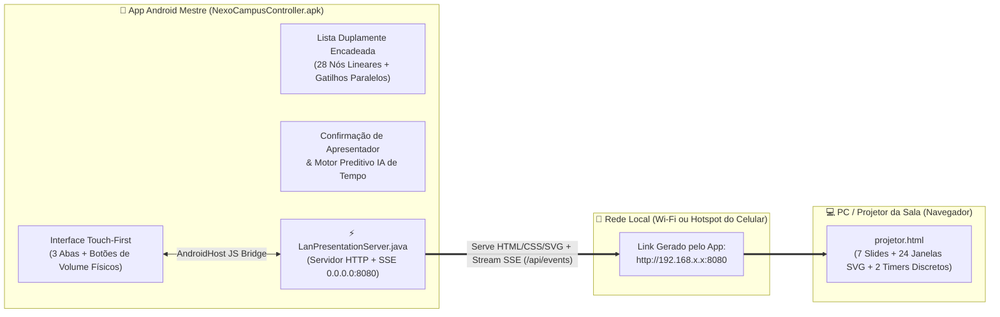

# 📱 Liderança, Comunicação e Conflitos em Equipes de Tecnologia
### Estudo de Caso: **Nexo Campus Tecnologia** — Seminário Grupo 3 (App Android Mestre + Projetor LAN)

📲 **Download Direto do Aplicativo Android (`.apk`):**  
👉 **[Baixar `NexoCampusController.apk`](./NexoCampusController.apk)** *(Servidor HTTP + SSE local embutido no celular)*

🌐 **Acesso Online Alternativo (GitHub Pages):**  
👉 **[Painel Mestre Web (`index.html`)](https://amandoluizdacruz.github.io/seminario-nexo-campus-slides/)** • **[Tela do Projetor (`projetor.html`)](https://amandoluizdacruz.github.io/seminario-nexo-campus-slides/projetor.html)**

> **Integrantes do Grupo 3:**
> - **Amando Luiz** (Slides 5, 6 e 7 — Propostas de Ação, Protocolo Prático e Reflexão Final)
> - **Yago Armand** (Slides 1 e 2 — Recorte do Problema e Base Conceitual I)
> - **Carlos** (Slides 3 e 4 — Base Conceitual II e Diagnóstico Causal)

---

## 🏗️ Arquitetura: App Android Mestre + Servidor Local Wi-Fi (LAN / Hotspot)

Em vez de depender de duas guias no mesmo computador, o **Controle Mestre da Apresentação** roda como um **Aplicativo Nativo Android (`NexoCampusController.apk`)** que hospeda seu próprio **Servidor HTTP + Server-Sent Events (SSE) em tempo real** na rede local (`porta 8080`).



---

## 🚀 Como Usar na Sala de Aula (Passo a Passo)

1. **Instale o App no Celular Android:**
   - Transfira ou baixe o arquivo **[`NexoCampusController.apk`](./NexoCampusController.apk)** no celular Android e instale-o.
2. **Conecte na Mesma Rede Local:**
   - Conecte o celular e o PC da sala no mesmo **Wi-Fi** *(Dica: em redes de faculdade com bloqueio entre dispositivos, basta ligar o **Roteador Wi-Fi / Hotspot** do próprio celular e conectar o PC da sala nele!)*.
3. **Abra o Link Gerado no Navegador do PC:**
   - Ao abrir o app **Nexo Campus Controle** no celular, o topo da tela exibe automaticamente o link da rede local (ex.: `http://192.168.43.1:8080` ou `http://192.168.0.105:8080`).
   - Digite esse link no navegador do PC conectado ao projetor da sala. A tela limpa da turma (`projetor.html`) abrirá instantaneamente e o app no celular mostrará **`🟢 1 PC(s) Conectado(s) na Sala`**.
4. **Controle Tudo pelo Celular:**
   - **Avanço Linear (Lista Duplamente Encadeada):** toque em **`Avançar Linearidade ➡`**, **`⬅ Nó Anterior`** ou use os **botões físicos de `Volume +` e `Volume -` do celular** para avançar/voltar pelos 28 nós sem precisar olhar para a tela!
   - **Gatilhos Manuais de Gráficos:** na aba **`🎛️ Gráficos & Controle`**, toque em qualquer card ou sub-aba para abrir/fechar os 24 modais e gráficos SVG na tela do PC em tempo real.
   - **Guia de Fala:** na aba **`🎙️ Guia de Fala`**, acompanhe o roteiro de fala exclusivo no celular.
   - **Confirmação de Apresentadores e Timers Preditivos:** toque em **`✅ Confirmar Início: Yago (04:00)`** e confirme as trocas para **Carlos (`04:30`)**, **Amando (`05:30`)** e **Perguntas (`04:00`)**.

---

## 💻 Como Compilar o APK ou Rodar o Servidor pelo PC

### Recompilar o APK Android (`android-app/build_apk.sh`)
```bash
./android-app/build_apk.sh
```

### Rodar o Servidor Local a partir do PC (Alternativa sem o APK)
Caso queira hospedar o servidor a partir do próprio notebook/PC e abrir o controle pelo navegador do celular (`http://<IP-DO-PC>:8080/control`):
```bash
python3 servidor_local.py
```

---

## 📁 Estrutura do Repositório

```text
├── NexoCampusController.apk    # Aplicativo Android pronto e assinado (v1 + v2 + v3)
├── android-app/                # Código-fonte Nativo Android (Java + SDK Build Pipeline)
│   ├── AndroidManifest.xml     # Permissões de rede LAN, Wi-Fi Lock, WakeLock e Vibrate
│   ├── build_apk.sh            # Script automatizado de build (aapt2 + javac + d8 + apksigner)
│   └── src/br/edu/nexocampus/controller/
│       ├── MainActivity.java           # WebView acelerada, JS Bridge (AndroidHost) e Volume Keys
│       └── LanPresentationServer.java  # Servidor HTTP + SSE + REST multi-thread embarcado
├── servidor_local.py           # Servidor LAN alternativo em Python para uso em desktop
├── index.html                  # Interface Mestre adaptada para Android Touch-First
├── projetor.html               # Tela Limpa da Sala de Aula servida ao PC via Wi-Fi
├── shared-data.js              # NexoSyncBus (AndroidHost + SSE + HTTP), Lista Encadeada e 24 Modais SVG
├── app.js                      # Lógica do App Mestre, abas mobile, confirmação de troca e timers
├── styles.css                  # Design System High-Contrast + Responsividade Mobile
└── assets/                     # Diagramas vetoriais animados (SVGs)
```
